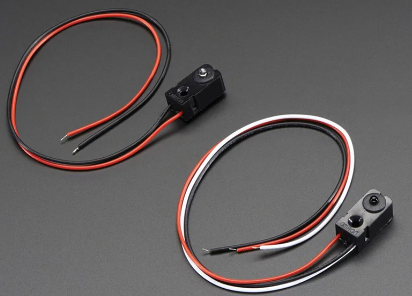
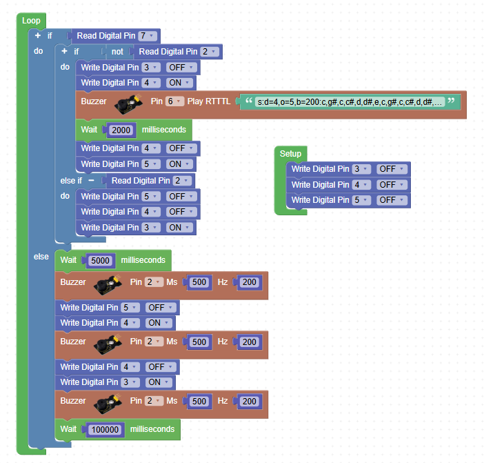
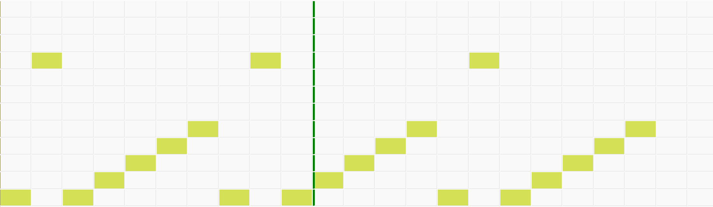
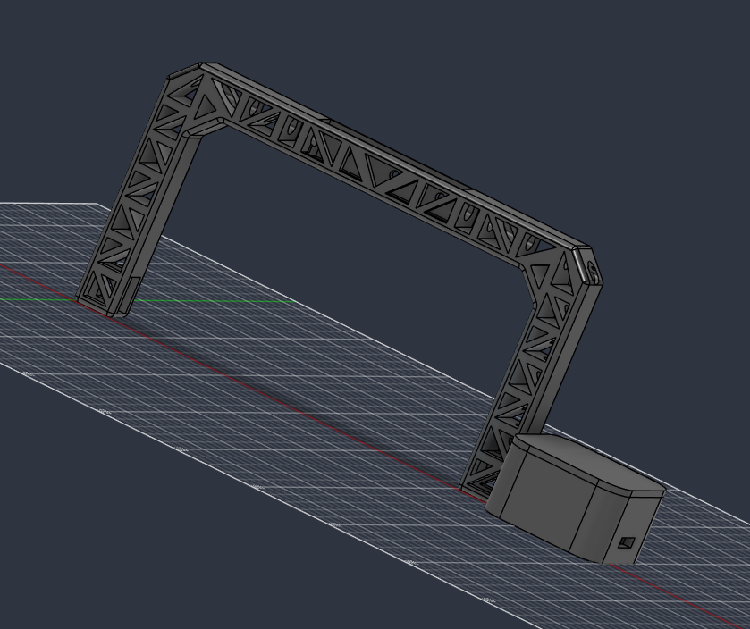
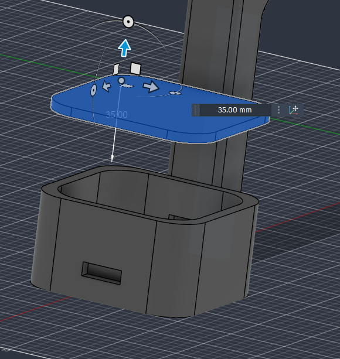
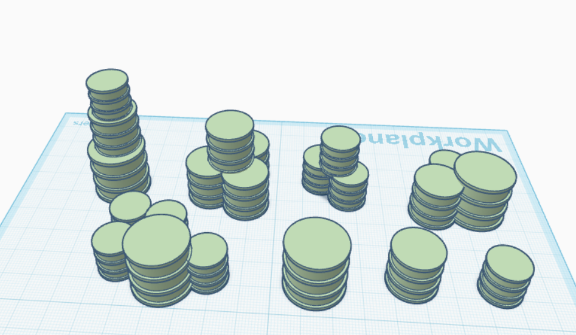
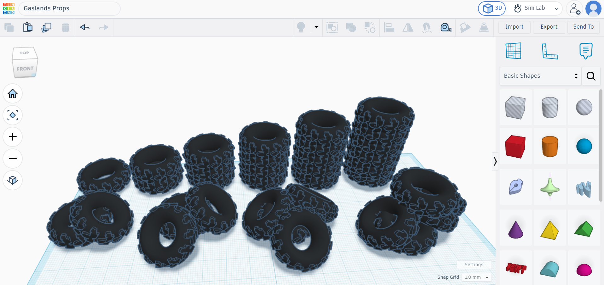
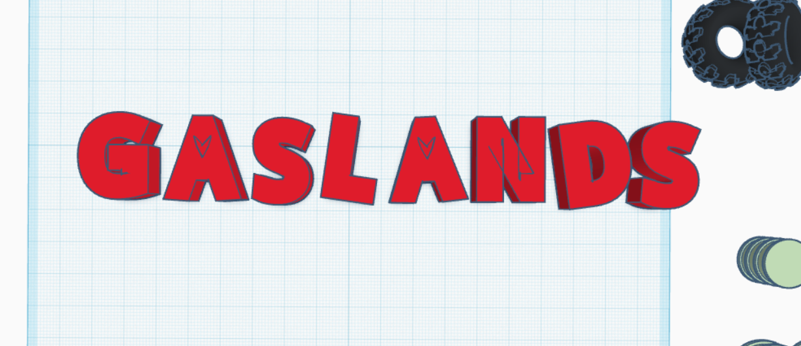

# Gaslands-Car-Detector-Gate
A project for week 2 of Half Life!
It is going to be a gate for Gaslands that has starting lights and detects when cars have finished the race. It will detect the cars by using an IR beam break sensor and will include LEDs and a buzzer as the actuators. I will be designing the majority of the project in Fusion360 but I will use TinkerCad to create barrels and props to make the environment feel right for the world it's set in. Well... that's the <em>vision</em>

I am using beam break sensors instead of an ultrasonic sensor because it will only require the car to be over a line of sight, instead of over both the speaker and microphone on the ultrasonic. They will also be easier to mount and make the coding easier because they simply output HIGH when nothing is there and LOW when there's something in the way.

The code has two modes that can be changed by switching a switch. 
- The first mode is for the start of the race, that will alternate the LEDs that are on from red, to orange, to green. On each change, a buzzer will make a sound. Two low beeps and then a high beep on green.
- The second mode is for the end of the race. When a car crosses the finish line, the lights will turn orange and an RTTTL will play (I will include more information below) and then it will go red.
Here is what the code in Steamakersblocks.com actually looks like:

For the end of the race, I decided that I wanted to play around with RTTTLs and make my own. I tried a few combinations, experimenting gradually rising and falling tones, as well as high and low beats next to each other. I finally landed upon this which I think works well. I might end up changing it later but I am happy with it. Here's a photo from the RTTTL maker.

I designed the majority of the Gaslands Gate in Fusion360. It has piping as holes to direct wires to the places they need to be (LEDs and sensor positions). I added some truss shapes to make it look more fit for the Gaslands universe.

There is a control box to the side which will house the arduino nano, switch, and buzzer. It has a lid that can come off to hide the parts. It is also connected to one of the IR sensor spots and the piping.

The .f3d and printable files are in this REPO.

To make my Gaslands Gate fit into the post apocalyptic setting, I designed some parts to hide the cleaner, component holding parts of my CAD design. I designed these in Tinkercad because it's easier to design less functional parts there.
I made barrels:

I made tires:

And I made a sign that reads GASLANDS to go on top of the gate!

My code as a .ino file can be found in this REPO. There is also additional information in my synced journal entries.
Thanks for reading me XD.
